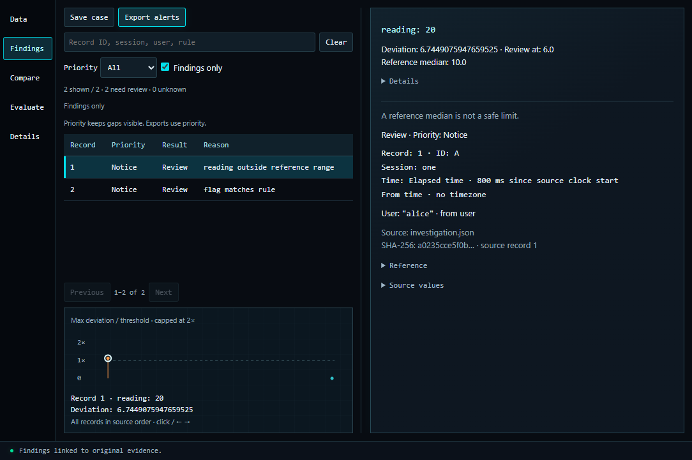

# Surge

[](https://github.com/seaboose/Surge/actions/workflows/ci.yml)

Surge is a Windows desktop tool for investigating telemetry and checking detection rules. Import a dataset, map its fields, inspect the evidence behind a finding, and compare results before and after a policy change.

The interface uses Electron and React. A separate Python process owns the data and runs the analysis. Once installed, Surge works locally without accounts, network access, or a listening server.



## What it does

- Imports CSV, JSON, and JSON Lines with record-level error messages and mapping checks.
- Compares numeric signals with a separate reference dataset, optionally grouped by category.
- Applies explicit field rules and keeps missing evidence visible.
- Searches records and field values, copies exact values, and links chart points to evidence.
- Saves self-contained cases and compares previous and current results record by record.
- Evaluates results against separately supplied labels, including false positives, missed targets, unresolved records, and subgroup results.

Surge produces review leads. A deviation is not proof of malicious behavior, and an unflagged record is not a safety guarantee. It does not collect game memory, enforce bans, or run a trained classifier.

## Set up on Windows

Install Python 3.11 or newer with Tcl/Tk, Node.js 22.12 or newer, and pnpm 11.25.0. Python 3.12 and Node 24 are the CI configuration. The Python engine uses the standard library only.

From the repository root, run:

```powershell
powershell -NoProfile -ExecutionPolicy Bypass -File .\Setup-Surge.ps1
.\Start-Surge.cmd
```

If Python is not on PATH, pass its executable explicitly:

```powershell
.\Setup-Surge.ps1 -Python 'C:\Python312\python.exe'
```

Setup creates `.venv`, installs the locked desktop dependencies, downloads Electron, and builds the interface. It stops on failure. No administrator privileges are needed. An existing environment is reused; moving the source to another computer requires running setup there.

`SURGE_PYTHON` can override the interpreter with an absolute executable path. Otherwise, Surge uses `.venv`. `Start-Surge-Legacy.cmd` opens the retained Tk interface; the newer evaluation and reference-group controls are in Electron.

## First investigation

1. Choose **Import data**, then map the fields you want to inspect.
2. For numeric comparisons, choose **Import reference** with a separate reference source. For explicit conditions, configure rules.
3. Resolve blocking mapping errors, review warnings, and choose **Analyze**.
4. Select a finding to inspect its values, conditions, source, and evidence gaps.
5. Use **Save case** to preserve the investigation. Use **Compare** to inspect changes against another case from the same source.
6. Use **Evaluate** to import separately prepared labels. Keep development and holdout labels separate from detector configuration.

## Verification

```powershell
.\.venv\Scripts\python.exe -B scripts/test.py
pnpm --dir desktop test
pnpm --dir desktop run test:ui
.\.venv\Scripts\python.exe -B scripts/check_release.py
```

Desktop tests use isolated profiles and synthetic data. They intercept dialogs and clipboard operations without changing a running investigation. Benchmark-dependent journeys are separate from CI and require the original evaluation archive.

The [evaluation notes](docs/evaluation.md) explain the measured results and limitations. The latest accepted policy reduced false positives on a held-out IoT sample, but its remaining false-positive rate is too high for deployment. A later Wipro-focused candidate was rejected because it lost detections. These measurements do not establish effectiveness against game cheats or attacks on AI systems.

See the [release verification](docs/release-checks.md) for the completed fresh-setup checks. To build a source-only zip, run `python scripts/package_source.py`. Local data, environments, and test output are excluded.

## Code and boundaries

Read the [architecture](docs/architecture.md), [security notes](SECURITY.md), and [development guide](desktop/README.md). The current bounded importer accepts up to 10,000 records and 16 MiB per source. Large-scale or continuous ingestion is outside this release.

This repository is a source distribution, not a signed installer. The application code is MIT licensed; dependency and dataset terms are listed in [NOTICE](NOTICE.md).
