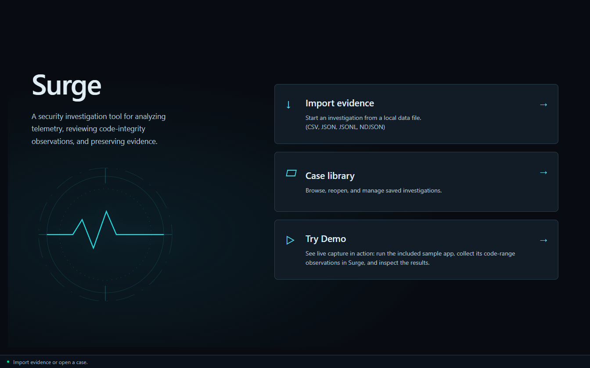
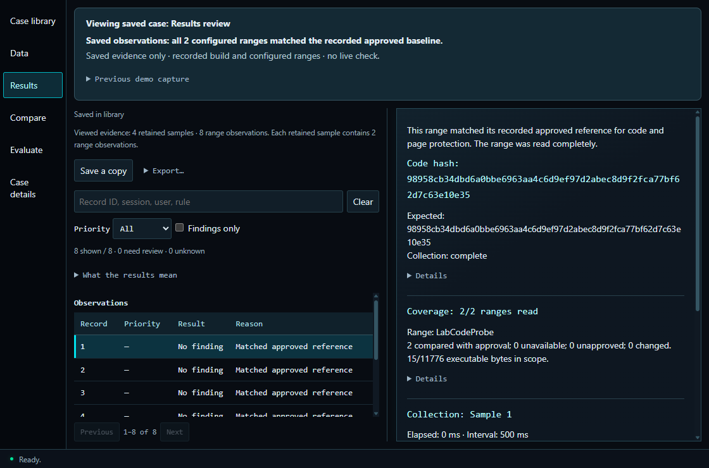

# Surge

[](https://github.com/seaboose/Surge/actions/workflows/ci.yml)

Surge collects runtime-integrity evidence from its own Windows application and helps you investigate what changed. A C++ collector measures configured DLL code ranges; a Python engine checks approved baselines; an Electron/React interface explains observations, reasons and coverage.

## Start an investigation

Choose **Try Demo**, then **Start collection**. The included v2 sample runs separately by design, exercising collection, transport, analysis and replay. **Inspect snapshot** opens a stable view while collection continues; **Stop collection** opens the final retained snapshot. For the exact approved sample build, complete observations of unchanged configured ranges should show **No finding**. Unapproved builds require review.

**Save case** preserves an investigation in the local **Case library**. Open, rename, delete, import and export cases there. Deleting a library entry preserves original evidence and the currently loaded snapshot. Reopening a case reviews recorded evidence, not current live integrity. Once installed, Surge works locally without accounts or a listening server.





*Recorded candidate interface. The results screenshot shows a saved case with two retained samples and four range observations, not live capture.*

For files, choose **Import evidence**, map fields or rules, then **Analyze**. CSV, JSON and JSON Lines are supported. Separate numeric reference data supports comparisons; **Evaluate** uses independent labels, while **Compare** examines the same source under different settings. **Case details** shows fingerprints, settings and provenance. **Alt+1–5** switches views; **Ctrl+plus/minus/0** controls zoom.

Small information buttons provide optional explanations for case files, sample counts and labeling. Case details keeps fingerprints visible, with analysis settings and numeric profiles available in expandable sections.

## Survive movement study

From this source workspace, open `Start-Surge.cmd` and choose **Survive sessions**
to record repeated Human, Scripted or Mixed game trials. The linked timeline,
arena replay, movement-rule graph and raw-record inspector show what Surge
observed. Recording and pausing the view are independent controls.

The [five-step workflow](docs/survive-workflow.md) connects the launcher, in-game
recording status, post-game review and report readiness. Each step has a focused
view; secondary details expand on demand. Drag the timeline overview to zoom,
open a counted event cluster for exact records, and resize the replay/evidence
panes. F10 or the game HUD button stops recording while gameplay continues;
partial evidence stays visible. Recorded time, receipt freshness and analyst
conclusions remain distinct.

The [investigation editor](docs/survive-investigations.md) attaches selected evidence
to analyst notes, preserves revision history, restores exact replay moments from
citations and exports a self-contained report. Notes never change detector inputs.

The combined standalone package runs the full workflow without an Unreal editor,
Python or Node installation. Extract it and open `Surge.exe`; follow the
[standalone demonstration guide](docs/standalone-demo.md). Its matching acceptance
report identifies the exact tested package. Building from source still requires
the [Survive Unreal project](unreal/SurgeMovementLab/README.md) and Unreal Engine 5.8.
See [runtime/development separation](docs/runtime-release-scope.md) for packaging,
saved-data locations and remaining distribution qualification.
Follow the [collection guide](docs/survive-study.md) and
[implementation review](docs/survive-implementation-review.md). Legal automation
can produce No finding; these movement checks do not classify all scripting.

## Scope and limits

Native coverage is **two ranges totaling 15 bytes**, with a **500 ms target interval**, up to **500 whole samples** in a byte-bounded window and a **10-minute session limit**. A versioned DLL manifest declares coverage and excluded executable bytes; approval binds the complete declaration. [Compatibility checks](docs/native-compatibility.md) exercise different builds, relocated loading and a third range.

Changes outside coverage or between samples can be missed. Missing approval requires Review; unreadable approved observations are Unknown. Review can coexist with collection gaps. Local unsigned evidence is not client attestation or whole-process assurance. Surge never attaches to games or Vanguard and does not enforce bans. File imports accept up to 10,000 records and 16 MiB per source.

## Open the Windows package

For a packaged candidate, extract the complete `Surge-<candidate>-windows-x64.zip`
and open `Surge.exe`. Python, Node.js and a compiler are not required. The included
sample has an approval for its exact build; startup never approves new builds.
Follow the [Windows package guide](docs/windows-package.md) for preserving cases,
replacing the folder and diagnosing startup failures. The accompanying generated
qualification report identifies the exact tested ZIP and remaining limitations.

The package is an unsigned review candidate. Unfamiliar-tester acceptance remains
pending; a successful automated run does not establish independent usability.

## Set up from source on Windows

Install Python 3.11+ with Tcl/Tk, Node.js 22.12+, and pnpm 11.25.0. CI uses Python 3.12 and Node 24. From the repository root:

```powershell
powershell -NoProfile -ExecutionPolicy Bypass -File .\Setup-Surge.ps1
.\Start-Surge.cmd
```

Setup creates `.venv`, installs locked dependencies and builds the interface. Run setup again after moving computers. Use `-Python 'C:\Python312\python.exe'` when Python is not on PATH.

Live collection also requires the [native build](native/README.md#build-once), CMake and Microsoft C++ Build Tools. Approving the exact build is a separate explicit step documented there. Without approval, observations require review. Portable case replay and ordinary imports do not require the native build.

## Replay the included cases

Run `python -B scripts/verify_native_demo.py` to verify five [sanitized cases](demos/native/README.md) without a compiler or running collector. After desktop setup, choose **Case library**, then **Open case file** to inspect one without adding it, or **Import case** to keep a library copy.

- **Approved update:** four No finding records.
- **Unapproved update:** four Review records; an unknown build is not necessarily malicious.
- **Changed code:** one Review, three No finding records.
- **Unreadable range:** one Unknown, three No finding records.
- **Outside coverage:** four No finding records despite a controlled change outside measured ranges.

These cases come from the owned app. Paths and process identities are removed; dates and timing are normalized. Code bytes, permissions and approval comparisons are preserved. They establish controlled behavior, not real-cheat accuracy.

## Verification and evidence

The [source candidate guide](docs/release-candidate.md) covers setup, preserving cases and the remaining release gates. [Focused visual checks](docs/visual-clarity-results.md) and [supported-limit measurements](docs/supported-limits-performance-results.md) identify their tested local snapshots. [Hosted recovery results](docs/hosted-recovery-results.md) identify the earlier recovery commit; they do not qualify subsequent UI or validation changes. Final combined-candidate qualification and unfamiliar-tester acceptance remain separate gates.

The required Windows `test` job runs the [deeper qualification profile](docs/hosted-deep-qualification.md) from a clean checkout before the existing UI and compatibility checks. It includes verified ASan controls, bounded properties, the parser pilot and fixed boundaries, and retention checks. Its portable evidence is retained on success or failure. This does not complete the broader fuzzing campaign or unfamiliar-tester acceptance.

Run `python -B scripts/check_first_use.py` for the permanent [first-use release check](docs/first-use-release-check.md). The same command runs in a separate Windows CI job and retains evidence on failure. It tests the extracted source package; unfamiliar-tester acceptance always remains pending.

[First-use results](docs/first-use-results.md): isolated setup and scripted workflows passed; unfamiliar-tester acceptance remains pending.

The [first-use acceptance criteria](docs/first-use-acceptance.md) separate isolated machine checks from [unfamiliar-participant tasks](docs/first-use-tester.md). Automated completion does not establish independent usability.

[Earlier release snapshot](docs/current-release-results.md): all 21 clean-checkout qualification steps and seven additional desktop journeys passed on that historical snapshot. Its results do not qualify the later combined candidate. Preserved failures and unfinished testing remain distinguished.

Run `python -B scripts/qualify.py` for the [defensive qualification](docs/qualification.md). Add `--asan --properties --libfuzzer --llvm-bin <LLVM-bin-directory> --retention` for all 21 existing checks. A graphical Windows session and documented build prerequisites are required. Each attempt generates JSON/Markdown reports and separate logs, stopping on failure.

The [current-release acceptance criteria](docs/current-release-acceptance.md) define this update's clean-checkout and additional desktop checks. Release-specific generated reports identify the exact tested snapshot. Earlier [retention qualification](docs/retention-results.md) and [UI results](docs/results-flow-results.md) retain their original provenance. Passing bounded parser, property and retention checks does **not** complete the original T1/T2/T3 fuzzing campaign, which remains unfinished.

```powershell
.\.venv\Scripts\python.exe -B scripts/test.py
.\.venv\Scripts\python.exe -B scripts/verify_native_demo.py
pnpm --dir desktop test
pnpm --dir desktop run test:ui
pnpm --dir desktop run test:accessibility
.\.venv\Scripts\python.exe -B scripts/check_release.py
```

The [performance/reliability report](docs/performance-reliability-results.md) records historical ten-minute measurements, twenty restarts and controlled collection failures. Those one-host results are not a new benchmark of this release or evidence of multi-hour endurance. The [replay correctness follow-up](docs/adversarial-correctness-results.md) preserves earlier failing regressions and fixes.

The separate [IoT evaluation](docs/evaluation.md) has a false-positive rate too high for deployment; a later candidate was rejected for losing detections. Neither evaluation establishes effectiveness against game cheats or attacks on AI systems. Desktop scaling checks cover 100–200% device scales, text enlargement and keyboard access, not screen-reader certification.

## Development and distribution

Use `pnpm --dir desktop dev` for the development inspector: right-click an
element to inspect its HTML/CSS, preview style changes and follow mapped JSX
sources. See [the learning walkthrough](docs/developer-inspection.md).
The packaged product disables DevTools and excludes development maps/helpers.
For a fresh Windows environment, use the separate [clean-machine qualification
kit](docs/clean-machine-qualification.md); a restricted developer-host run is not
a substitute for a clean-machine result.

Use the [code learning map](docs/code-map.md) to follow one session through the
maintained runtime. Keep one source tree with separate runtime and development
packages: tests, build tools, dependency caches and historical verification output
are not prerequisites for learning the user-facing workflow or installed payload.

Read the [architecture](docs/architecture.md), [security notes](SECURITY.md), [development guide](desktop/README.md), and [release checks](docs/release-checks.md). The renderer is sandboxed and cannot provide arbitrary paths or commands to collection.

The [Windows package acceptance criteria](docs/windows-package-acceptance.md)
define separate build and downloaded-package checks, with explicit resource limits
and preserved failure evidence. The [package release check](docs/windows-package-check.md)
documents the build, CI gate and report verification. [Participant tasks](docs/windows-package-tester.md)
and a [blank session record](docs/windows-package-session-record.md) are provided
for the still-pending unfamiliar-user session.

Run `python scripts/package_source.py` to package source. Published demo/evaluation evidence is included; local captures, approvals, environments and test outputs are excluded. This is a source distribution, not a signed installer. Application code is MIT licensed; dependency and dataset terms are in [NOTICE](NOTICE.md).
