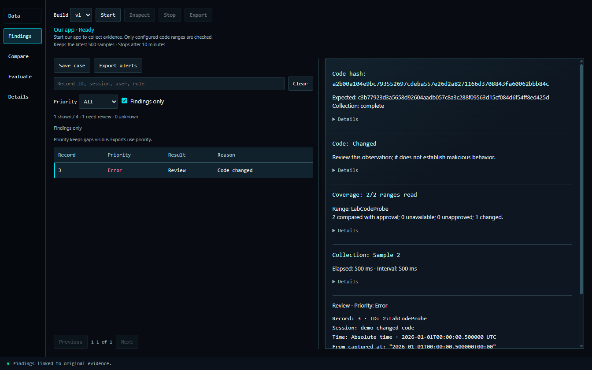

# Surge

[](https://github.com/seaboose/Surge/actions/workflows/ci.yml)

Surge collects runtime-integrity evidence from its own Windows application and helps you investigate what changed. A C++ collector measures configured DLL code ranges; a Python engine checks approved baselines; an Electron/React interface shows the observations, reasons and coverage behind each result.

Choose **Our app → Start → Inspect** to open a stable snapshot while collection continues. **Stop** opens the final retained snapshot; **Export** saves observations and **Save case** preserves an investigation. Once installed, Surge works locally without accounts or a listening server.



*Current interface replaying the sanitized code-change demo. Collection controls are ready; this screenshot is not a live capture.*

Surge also imports CSV, JSON and JSON Lines, supports field rules and separate numeric reference data, and evaluates findings against independent labels. Search, exact-value inspection, linked chart points and case comparison support investigation.

Native coverage is **two ranges totaling 15 bytes**, with a **500 ms target interval**, up to **500 samples** in a byte-bounded window and a **10-minute session limit**. A versioned DLL manifest declares coverage and excluded executable bytes; approval binds the complete declaration. [Compatibility checks](docs/native-compatibility.md) exercise different builds, relocated loading and a third declared range. Changes outside coverage or between samples can be missed. Missing approval requires review; missing observations remain Unknown. Local unsigned evidence is not client attestation. Surge never attaches to games or Vanguard and does not enforce bans.

## Try the demo

With Python 3.11 or newer, run from the repository root:

```powershell
python -B scripts/verify_native_demo.py
```

This replays five [sanitized cases](demos/native/README.md) and checks separately declared outcomes, without a compiler or running collector. After desktop setup, use **Open case** to inspect them:

- **Approved update:** four No finding records.
- **Unapproved update:** four Review records; an unknown build is not necessarily malicious.
- **Changed code:** one Review, three No finding records.
- **Unreadable range:** one Unknown, three No finding records.
- **Outside coverage:** four No finding records despite a controlled change outside the checked ranges—a documented blind spot.

The cases derive from our own app. Local paths and process identities are removed; dates and timing are normalized. Code bytes, permissions and approval comparisons are preserved. These are controlled correctness checks, not real-cheat accuracy results. [Demo notes](demos/native/README.md) explain normalization and optional regeneration.

## Set up on Windows

Install Python 3.11+ with Tcl/Tk, Node.js 22.12+, and pnpm 11.25.0. CI uses Python 3.12 and Node 24.

From the repository root, run:

```powershell
powershell -NoProfile -ExecutionPolicy Bypass -File .\Setup-Surge.ps1
.\Start-Surge.cmd
```

Setup creates `.venv`, installs locked dependencies and builds the interface. Run setup again after moving to another computer. Use `-Python 'C:\Python312\python.exe'` if Python is not on PATH.

Live collection also requires the optional [native build](native/README.md#build-once), using CMake and Microsoft C++ Build Tools. Approving a build is a separate, explicit step documented there. Without approval, its observations require review. Demo replay and ordinary imports do not require the native build.

For files, choose **Import data**, map fields or rules, then **Analyze**. Use separate reference data for numeric comparisons and independent labels in **Evaluate**. **Compare** examines decisions from the same source under different settings. **Alt+1–5** switches views; **Ctrl+plus/minus/0** adjusts or resets zoom.

## Verification

```powershell
.\.venv\Scripts\python.exe -B scripts/test.py
.\.venv\Scripts\python.exe -B scripts/verify_native_demo.py
pnpm --dir desktop test
pnpm --dir desktop run test:ui
pnpm --dir desktop run test:accessibility
.\.venv\Scripts\python.exe -B scripts/check_release.py
```

CI also replays the demo through the desktop interface. Tests use isolated profiles; scaling checks cover 100–200% Electron device scales, text enlargement and keyboard access, not screen-reader certification.

The [native validation report](evidence/native-stream-validation.json) and [release checks](docs/release-checks.md) record controlled scenarios, replay, resource measurements and fresh installation. Separate [IoT evaluation results](docs/evaluation.md) retain a false-positive rate too high for deployment; a later candidate was rejected for losing detections. Neither evaluation establishes effectiveness against game cheats or attacks on AI systems.

To build a source package, run `python scripts/package_source.py`. Published demo and evaluation evidence are included; local captures, approvals, environments and test output are excluded.

## Code and boundaries

Read the [architecture](docs/architecture.md), [security notes](SECURITY.md), and [development guide](desktop/README.md). File imports accept up to 10,000 records and 16 MiB per source. The renderer is sandboxed and cannot supply arbitrary paths or commands to collection.

This repository is a source distribution, not a signed installer. The application code is MIT licensed; dependency and dataset terms are listed in [NOTICE](NOTICE.md).
